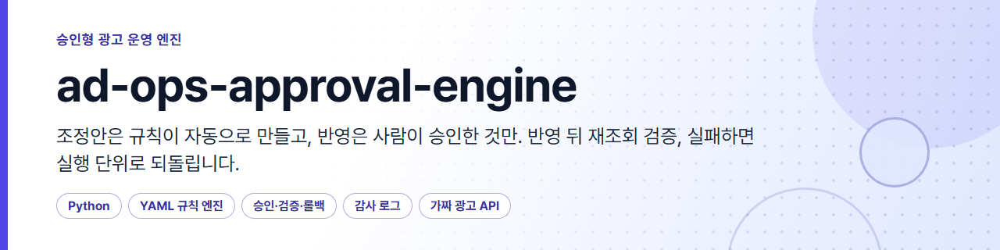
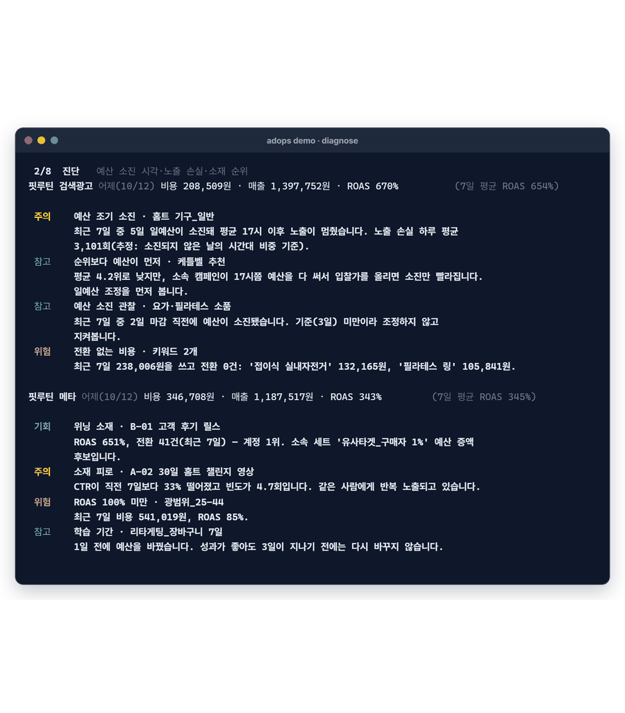
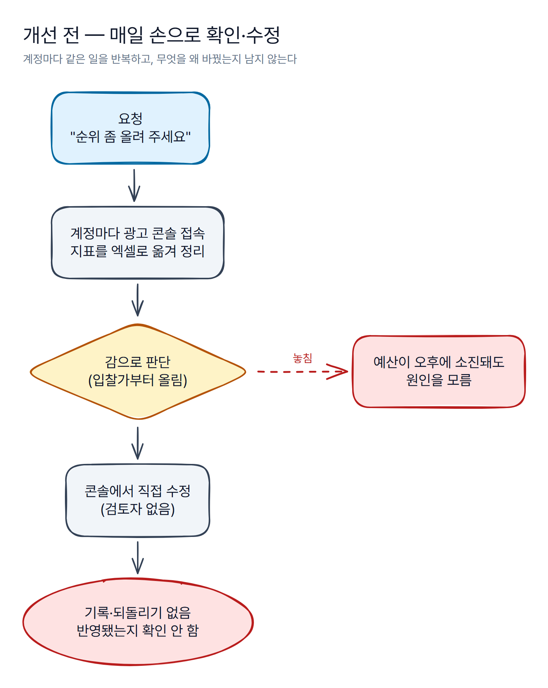
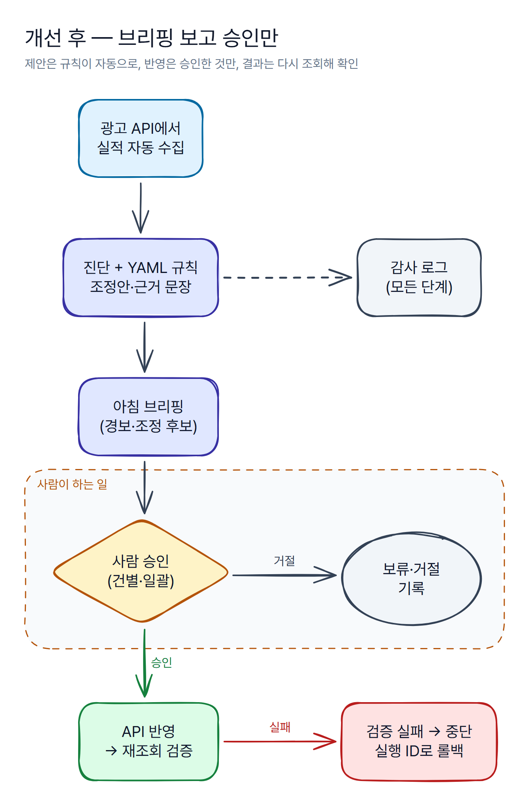
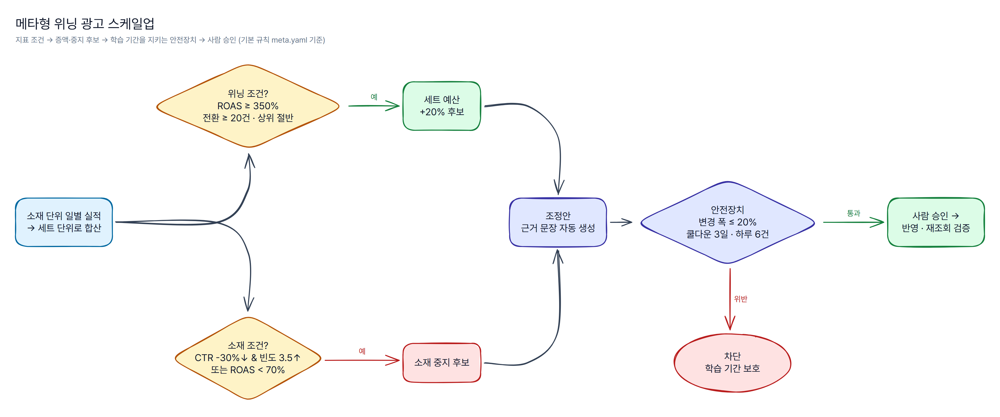
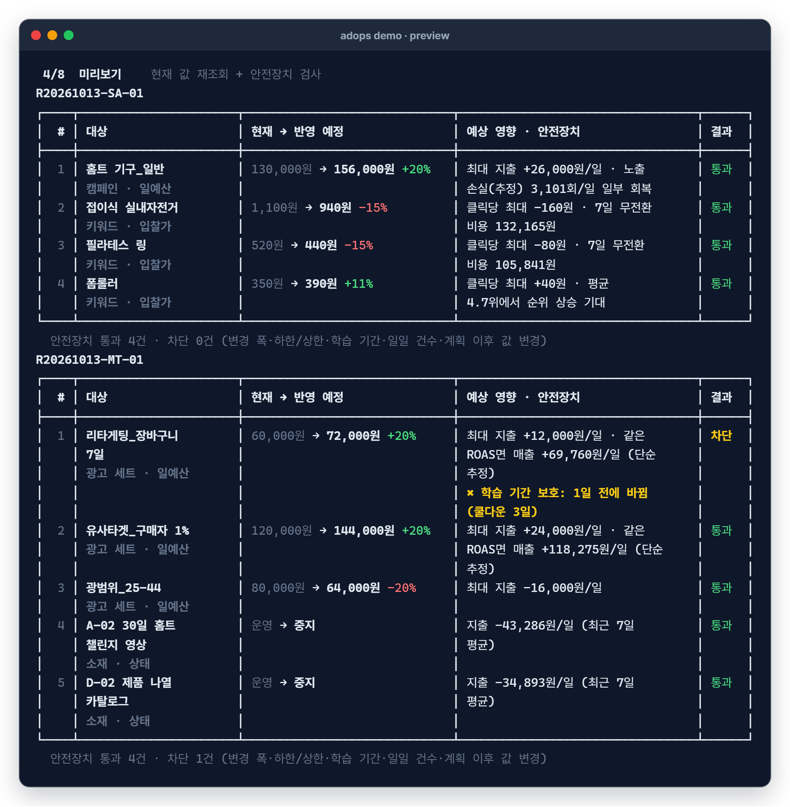
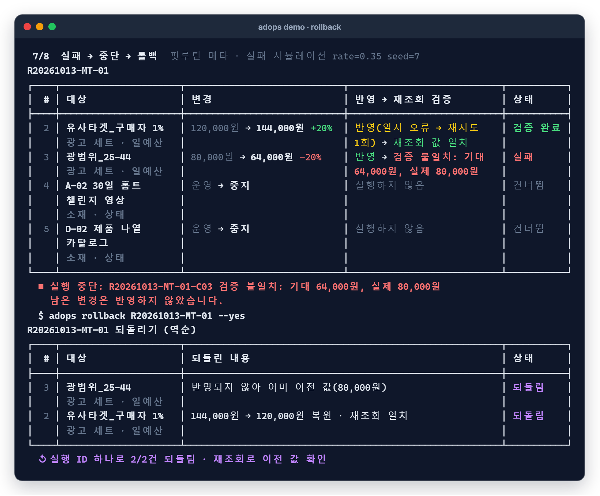
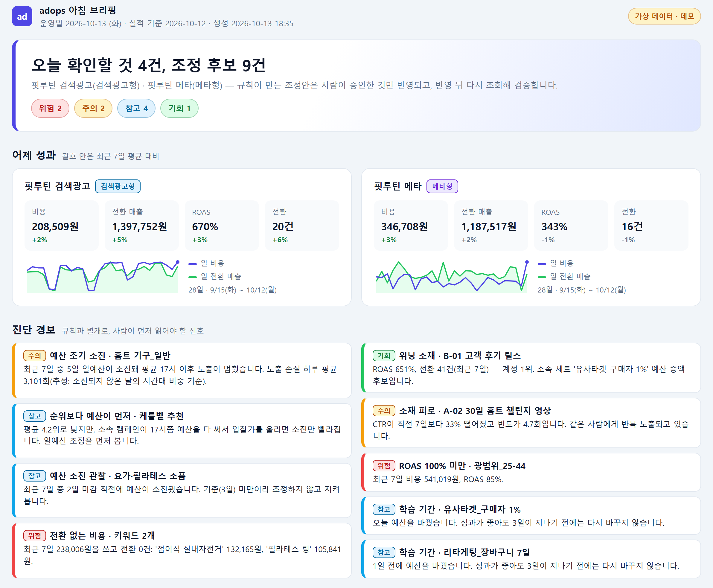
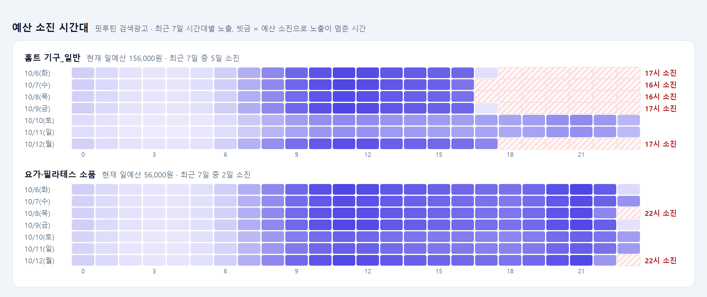
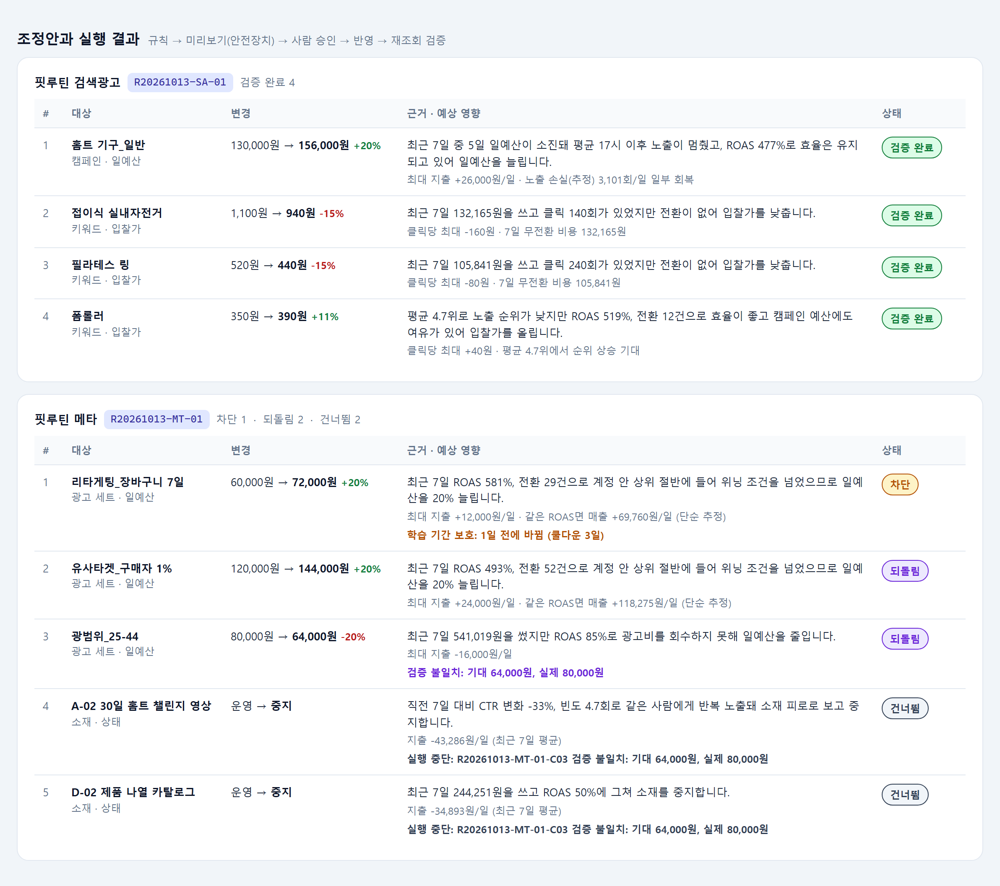

# ad-ops-approval-engine

> 광고 계정 데이터를 매일 진단해 **규칙으로 조정안을 만들고, 사람이 승인한 것만 반영하고, 반영 뒤 다시 조회해 검증하고, 문제가 생기면 실행 ID 하나로 되돌리는** 승인형 광고 운영 엔진입니다.

*English summary is at the [bottom](#english-summary).*

[](https://github.com/workzeroai/ad-ops-approval-engine/actions/workflows/ci.yml)




*데모의 브랜드(핏루틴)·계정·실적은 모두 생성 스크립트로 만든 가상 데이터입니다. 실제 광고 API는 호출하지 않습니다.*

## 문제 (Why)

- **매일 같은 확인을 손으로 반복한다.** 계정마다 광고 콘솔에 들어가 지표를 옮겨 적고, 입찰가·예산을 직접 고친다. 무엇을 왜 바꿨는지 기록이 남지 않고, 반영됐는지 다시 확인하지도 않는다.
- **요청이 문제를 잘못 정의한다.** "순위 좀 올려 주세요"라는 요청에 입찰가부터 올리지만, 실제 원인은 **오후에 일예산이 소진돼 노출이 끊기는 것**인 경우가 많다. 이때 입찰가를 올리면 소진만 빨라진다.
- **완전 자동화는 맡기기 어렵다.** 광고비가 걸린 변경을 규칙이 바로 반영하면, 잘못된 규칙 하나가 하루 예산을 날린다. 현업은 "누가 확인했는지, 되돌릴 수 있는지"를 먼저 묻는다.

## 개선 전 / 후 흐름

| 개선 전 | 개선 후 |
|---|---|
|  |  |

<!-- 도면 원본: assets/diagrams/*.excalidraw (excalidraw.com 또는 Obsidian에서 편집) · 사양: *.yaml -->

## 구조


```text
ad-ops-approval-engine/
├─ adops/
│  ├─ adapters/          # 플랫폼 어댑터 인터페이스 + 가짜 광고 API + 검색광고형·메타형 매핑(+실연동 자리)
│  ├─ diagnose.py        # 예산 소진 시각·노출 손실 추정·순위보다 예산·위닝/피로 소재
│  ├─ rules/             # YAML 규칙 엔진 + 기본 규칙(defaults/searchad.yaml, meta.yaml)
│  ├─ plan.py            # 조정안 + 근거 문장 + 예상 영향
│  ├─ safety.py          # 안전장치 검사(변경 폭·하한/상한·학습 기간·일일 건수·값 변경 감지)
│  ├─ execute.py         # preview → approve → apply → verify → rollback
│  ├─ audit.py           # SQLite 감사 로그(runs·changes·events)
│  ├─ brief.py           # HTML 아침 브리핑(templates/brief.html.j2)
│  ├─ fakedata.py        # 가상 브랜드 28일 데이터 생성기
│  └─ cli.py, demo.py    # adops 명령, adops demo
├─ examples/             # 사용자 정의 규칙 예시(보수적 운영)
├─ data/seed/            # 생성 스크립트 산출물(가상 데이터)
├─ scripts/              # 가상 데이터·데모 이미지 생성
├─ tests/                # pytest 80개
└─ docs/                 # 구조·안전장치·규칙 문서, 데모 이미지
```

| 모듈 | 하는 일 |
|---|---|
| 어댑터 | 엔진은 `get_entities · get_stats · get_state · apply_change` 네 메서드만 안다. 검색광고형(camelCase·ON/OFF·시간대별 노출)과 메타형(숫자를 문자열로, 전환은 `actions` 목록 안)의 서로 다른 응답을 공통 모델로 바꾼다. |
| 진단 | 시간대별 노출이 하루가 끝나기 전에 0이 된 날을 **예산 소진일**로 세고, 소진되지 않은 날의 시간대 비중으로 **노출 손실을 추정**한다. 순위가 낮은 키워드라도 캠페인 예산이 먼저 소진되면 "순위보다 예산이 먼저"로 표시한다. |
| 규칙 | 조건(지표·비교·임계값, `all`/`any` 중첩) → 액션(증액·감액·지정·중지). 지표 이름이 틀리면 불러올 때 사용 가능한 이름과 함께 알려 준다. |
| 계획 | 규칙에 걸린 개체마다 새 값(반올림·규칙 하한/상한)과 **근거 문장**, **예상 영향**을 만든다. 같은 개체·필드에 규칙이 겹치면 위쪽 규칙만 쓴다. |
| 실행·감사 | 아래 상태 전이만 허용하고, 모든 전이와 API 오류·재시도·중단·되돌리기를 SQLite에 남긴다. |

### 규칙은 YAML로 — 마케터가 직접 고친다

기본 규칙: [`adops/rules/defaults/searchad.yaml`](adops/rules/defaults/searchad.yaml) · [`meta.yaml`](adops/rules/defaults/meta.yaml) · 지표 목록: [docs/rules.md](docs/rules.md)

```yaml
platform: searchad_like
guardrails:
  max_change_pct: 30        # 변경 1건의 변경 폭 상한(%). 넘으면 미리보기에서 차단
  max_changes_per_day: 10   # 계정당 하루 반영 건수 상한
  cooldown_days: 1          # 같은 개체를 다시 바꾸기 전에 기다릴 날 수
  bounds:
    bid: {min: 70, max: 100000}
rules:
  - id: sa-bid-up-efficient
    name: 순위 낮고 효율 좋은 키워드 입찰가 인상
    entity: keyword
    when:
      all:
        - {metric: avg_rank_7d, op: ">=", value: 4.0}
        - {metric: roas_7d, op: ">=", value: 400}      # ROAS 400%
        - {metric: conv_7d, op: ">=", value: 5}
        # 예산이 먼저 소진되는 캠페인에서는 입찰가를 올리면 소진만 빨라진다
        - {metric: campaign_exhausted_days_7d, op: "<", value: 3}
    action: {field: bid, op: increase_pct, value: 10, round_to: 10, max: 3000}
    reason: >-
      평균 {avg_rank_7d}로 노출 순위가 낮지만 ROAS {roas_7d}, 전환 {conv_7d}건으로 효율이 좋고
      캠페인 예산에도 여유가 있어 입찰가를 올립니다.
```

`reason`의 `{지표}` 자리에 실제 값이 단위와 함께 들어가 조정안마다 근거 문장이 됩니다. 예) *"평균 4.7위로 노출 순위가 낮지만 ROAS 519%, 전환 12건으로 효율이 좋고 캠페인 예산에도 여유가 있어 입찰가를 올립니다."* (가상 데이터)

### 메타형 위닝 광고 스케일업

같은 엔진에 규칙 파일만 바꿔 메타형 광고에 적용합니다. 검색광고와 달리 **예산을 크게 바꾸면 학습 단계가 다시 시작될 수 있어** 변경 폭 상한을 20%로 낮추고, 같은 광고 세트는 3일 안에 다시 바꾸지 않습니다(학습 기간 보호). 소재는 CTR 급락과 빈도 상승을 함께 보고 피로를 판단합니다.



## 안전장치


| 위험 | 장치 | 어디서 |
|---|---|---|
| 승인 없이 반영 | `approved` 상태가 아니면 반영 함수가 예외를 던진다. 상태 전이 표에서 `applied`로 들어오는 길은 `approved`뿐 | `models.ALLOWED_TRANSITIONS`, `execute.apply_one` |
| 한 번에 너무 크게 바꿈 | 1회 변경 폭 상한(검색광고형 30%, 메타형 20%), 필드별 절대 하한·상한 | `safety.check_change` |
| 하루에 너무 많이 바꿈 | 계정당 일일 반영 건수 상한. 미리보기에서 차단하고, 반영 직전에 다시 확인해 넘으면 건너뜀 | `safety.daily_cap_violation` |
| 학습 중인 광고를 또 건드림 | 마지막 변경 후 N일(메타형 3일)이 지나지 않으면 차단 | `cooldown_days` |
| 계획 뒤 누군가 콘솔에서 값을 바꿈 | 미리보기 때 현재 값을 다시 조회해 계획 당시 값과 다르면 차단(오래된 조정안으로 덮어쓰지 않음) | `drift` 검사 |
| "응답은 성공인데 값은 그대로" | 반영 직후 다시 조회해 값이 맞는지 검증. 불일치면 `failed` | `execute.apply_one` |
| 실패 뒤에도 계속 반영 | 한 건이라도 실패하면 남은 승인 건은 `skipped`로 두고 실행 중단 | `execute.apply` |
| 일시 오류(503 등) | 일시 오류만 재시도(기본 2회), 영구 오류(400·404)는 바로 실패 | `_call_with_retry` |
| 되돌리기 | 실행 ID 하나로 반영된 변경을 **역순으로** 이전 값으로 복원하고 다시 조회해 확인. 반영되지 않았던 건은 그대로 둠 | `execute.rollback` |
| 누가 무엇을 했는지 모름 | 생성·미리보기·승인(승인자 이름)·반영·검증·실패·중단·되돌리기를 모두 SQLite `events`에 추가만 함 | `audit.AuditStore` |
| 비밀값 | 실연동 키는 `.env`로만(커밋 금지, `.env.example`만 둠). 이 저장소는 키 없이 가짜 API로만 동작 | `.gitignore` |

자세한 설명: [docs/safety.md](docs/safety.md) · 구조: [docs/architecture.md](docs/architecture.md)

### 왜 자동 반영이 아니라 승인인가

- **광고비가 걸린 변경이다.** 규칙이 틀리면 하루 예산이 그대로 나간다. 조정안을 만드는 일은 기계가 빠르고, "이번 주는 프로모션이라 예외"처럼 맥락을 아는 판단은 사람이 빠르다. 그래서 **제안은 자동, 반영은 승인**으로 나눴다.
- **되돌릴 수 있어야 현업이 맡긴다.** 승인만으로는 부족하다. 반영 결과를 다시 조회해 확인하고, 이상하면 실행 단위로 한 번에 되돌릴 수 있어야 담당자가 매일 쓰게 된다.
- **사람 검토 시간을 줄이는 쪽으로 설계했다.** 승인자가 지표를 다시 찾아보지 않도록 조정안마다 근거 문장과 예상 영향을 붙이고, 안전장치를 통과한 건만 승인 대상으로 올린다. 아침 브리핑 한 장을 보고 승인만 하면 된다.
- **자동 반영으로 넘어갈 길은 열어 두었다.** 조정안마다 위험 등급(`risk: low|medium|high`)이 붙어 있어, 낮은 등급(예: 전환 없는 키워드 입찰가 인하)만 자동 승인하는 정책을 승인 단계 앞에 얹을 수 있다. 그 경우에도 안전장치·재조회 검증·감사 로그는 그대로 적용된다(아직 구현하지 않음).

## 빠른 실행 (가짜 모드, API 키 불필요)

```bash
git clone https://github.com/workzeroai/ad-ops-approval-engine.git && cd ad-ops-approval-engine
pip install -e .
adops demo
```

`adops demo` 한 번에 **가상 데이터 생성 → 진단 → 조정안 → 미리보기(안전장치) → 승인(데모 전용 자동 승인) → 반영·재조회 검증 → 실패 1건과 실행 중단·롤백 → HTML 브리핑**까지 돕니다. 실패는 `seed`를 고정한 실패 시뮬레이션이라 매번 같은 지점에서 재현됩니다.

**데모 결과 (가상 데이터 기준)**

| 단계 | 결과 |
|---|---|
| 진단 | 검색광고형: '홈트 기구_일반' 캠페인 최근 7일 중 5일 예산 소진(평균 17시), 노출 손실 하루 3,101회(추정) · 메타형: 위닝 소재 1개, 피로 소재 1개, ROAS 100% 미만 세트 1개 |
| 조정안 | 9건(검색광고형 4, 메타형 5), 건마다 근거 문장 자동 생성 |
| 미리보기 | 8건 통과, 1건 차단(전날 예산을 바꾼 광고 세트 — 학습 기간 보호) |
| 반영·검증 | 검색광고형 4건 반영 후 재조회 값 일치 |
| 실패·롤백 | 메타형: 1건 일시 오류 → 재시도 성공, 다음 건 검증 불일치(응답은 성공, 값 미반영) → 실행 중단, 남은 2건 건너뜀 → `adops rollback` 실행 ID 하나로 2건 되돌림 |
| 기록 | 감사 로그 54건, 브리핑 HTML 1장 |

| 미리보기: 안전장치가 학습 중인 세트를 차단 | 실패 → 중단 → 롤백 |
|---|---|
|  |  |

**아침 브리핑** (`adops brief`, HTML 한 장 · 가상 데이터)



| 예산 소진 시간대(빗금 = 소진 후 노출 멈춤) | 조정안과 실행 결과 |
|---|---|
|  |  |

<details>
<summary><b>단계별로 직접 실행하기</b> (사람이 승인하는 실제 흐름)</summary>

```bash
adops seed                                   # 가상 데이터 새로 만들기(.adops/)
adops diagnose                               # 진단 경보
adops plan -a sa-fitroutine                  # 조정안 → 실행 ID 발급(예: R20261013-SA-01)
adops preview R20261013-SA-01                # 현재 값 재조회 + 안전장치 검사
adops approve R20261013-SA-01                # 한 건씩 y 승인 / n 거절 / s 보류 / a 나머지 모두 승인
adops apply R20261013-SA-01                  # 승인된 것만 반영 → 재조회 검증
adops apply R20261013-MT-01 --fail-rate 0.35 # 실패 시뮬레이션(재현용 --fail-seed)
adops rollback R20261013-MT-01               # 실행 ID 단위 되돌리기
adops history --run R20261013-MT-01          # 감사 로그
adops brief --open                           # HTML 브리핑
adops plan -a sa-fitroutine -r examples/rules.searchad.yaml   # 내 규칙 파일로
```

개발: `pip install -e ".[dev]" && pytest && ruff check .`
</details>

## 실무 적용 사례

> 아래 수치는 **실제 회사 운영 결과이며 이 저장소의 데모와 무관합니다.** 같은 설계 아이디어(진단 → 조정안 → 사람 승인 → API 반영 → 재조회 검증)를 회사 업무에 적용한 결과이고, 이 저장소는 그 아이디어를 가상 데이터로 처음부터 다시 구현한 것입니다. 회사 코드·데이터·계정은 쓰지 않았습니다.

- 검색광고 3개 계정: API 반영 37건, 실행 오류 0
- 2주 비교: 노출 +67%, 평균 노출순위 2.7 → 2.1위, 클릭당 비용 +0.8%(유지)
- 1개 계정의 예산 상한 근접일 4일 → 0일
- 사람 검토 시간: 하루 10~20분(추정)

## 한계와 다음 단계

**한계**

- **가짜 광고 API로만 동작합니다.** 응답 모양·오류·지연은 단순화했고, 실제 플랫폼의 호출량 제한·부분 성공·비동기 반영은 재현하지 않습니다.
- **예상 영향은 최근 7일 실적으로 한 단순 계산**입니다(예: 같은 ROAS면 매출 +N원). 예측 모델이 아닙니다.
- **노출 손실은 추정치**입니다. 소진되지 않은 날의 시간대별 노출 비중으로 계산하며, 경쟁 입찰 변화는 반영하지 않습니다.
- 규칙 기반 엔진입니다. 조정안을 LLM이 판단하지 않습니다.
- 승인은 CLI 대화형뿐이고, 작업 폴더는 로컬 파일(JSON·SQLite) 하나라 여러 사람이 동시에 쓰는 구조는 아닙니다.

**다음 단계**

- **실연동 어댑터:** `SearchAdLiveAdapter`·`MetaLiveAdapter` 자리에 서명(HMAC-SHA256)·토큰 인증, 호출량 제한 대응(지수 백오프)을 넣어 실제 API를 붙인다. 엔진·규칙·안전장치는 그대로 쓴다.
- **채팅 승인:** 조정 후보를 Discord/Slack으로 보내고 이모지·버튼으로 승인(승인자 이름을 감사 로그에 기록).
- **웹 대시보드:** 브리핑을 웹 화면으로 옮겨 실행 이력 검색, 건별 승인·되돌리기를 화면에서.
- **반영 후 효과 측정:** 변경 전후 N일 지표를 자동 비교해 규칙별 성과를 브리핑에 표시.

---

## English summary

**ad-ops-approval-engine** is an approval-first ad operations engine. Every morning it diagnoses ad accounts (budget exhaustion hour, estimated lost impressions, winning/fatigued creatives), turns YAML rules into proposed changes with auto-generated rationale and expected impact, and **applies only what a human approved**. Each change is re-read from the platform right after it is applied; a single mismatch halts the run, and the whole run can be **rolled back by its run ID**. Guardrails cap change size, daily change count, absolute bounds, and protect learning periods (cooldown), and every step is written to a SQLite audit log. A self-contained HTML morning brief summarizes it all.

It ships with a fake ad platform (search-ads-like and Meta-like adapters behind one interface, with a seeded failure simulator) and a fictional brand, so `pip install -e . && adops demo` runs end to end without API keys. 80 pytest tests, 96% coverage, ruff-clean. Real API adapters, chat-based approval and a web dashboard are listed as next steps. The "in production" figures above are from the author's real work and are unrelated to this demo.

**만든 사람 · Author** — 전병국 · [workzeroai@gmail.com](mailto:workzeroai@gmail.com) · [GitHub](https://github.com/workzeroai) · [포트폴리오](https://workzero.notion.site/AX-_-3d312e3c61c981958e60f69a8f6d546e)

---

MIT © workzeroai
