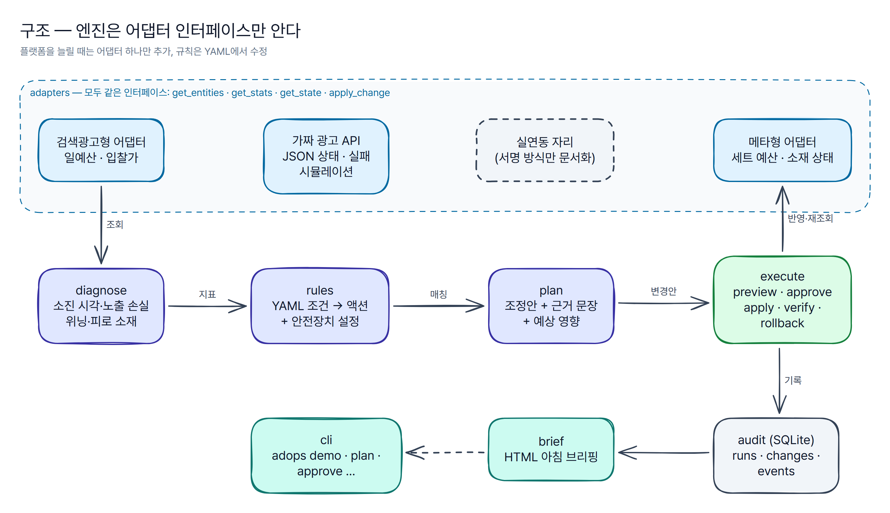

# 구조



## 흐름

```text
adapter.get_entities/get_stats ──► diagnose ──► rules.evaluate ──► plan ──► audit(runs·changes: planned)
                                                                              │
              브리핑(brief) ◄── audit(events) ◄── execute: preview → approve → apply → verify → rollback
                                                              │                   │
                                                  adapter.get_state       adapter.apply_change
```

1. **diagnose** — 어댑터에서 개체와 28일 일별 실적을 읽어 개체별 지표(최근 7일 비용·ROAS·예산 소진일·노출 손실 추정 등)와 경보(Finding)를 만든다.
2. **rules** — YAML 규칙을 위에서부터 평가해 (규칙, 개체) 매칭 목록을 만든다.
3. **plan** — 매칭마다 새 값·근거 문장·예상 영향을 계산해 실행(Run)과 변경(Change)으로 저장한다. 실행 ID는 `R{운영일}-{SA|MT}-{순번}`.
4. **execute** — 미리보기(현재 값 재조회 + 안전장치) → 승인 → 반영 → 재조회 검증 → (필요하면) 되돌리기.
5. **audit** — 모든 상태 전이와 오류·중단·되돌리기를 SQLite에 추가한다.
6. **brief** — 진단과 최근 실행·이력을 HTML 한 장으로 만든다.

## 어댑터 인터페이스

```python
class AdPlatformAdapter(ABC):
    def get_entities(self, entity_type=None) -> list[Entity]: ...
    def get_stats(self, start, end, level) -> list[DailyStat]: ...
    def get_state(self, entity_id) -> Entity: ...      # 검증용: 캐시 없이 다시 조회
    def apply_change(self, entity_id, field, value) -> None: ...   # 실패하면 ApiError
```

| 어댑터 | 원본 응답 | 바꿀 수 있는 필드 |
|---|---|---|
| `SearchAdLikeAdapter` | camelCase 필드(`dailyBudget`, `bidAmt`), 중지는 `userLock: true`, 캠페인 실적에 시간대별 노출 24칸 | 캠페인 일예산·상태, 키워드 입찰가·상태 |
| `MetaLikeAdapter` | 숫자를 문자열로(`"spend": "51234"`), 전환은 `actions` 목록 안, 실적은 소재 단위 → 세트·캠페인은 합산 | 광고 세트 일예산·상태, 소재 상태 |
| `*LiveAdapter` | 실연동 자리(구현하지 않음). 서명·인증 방식만 주석으로 정리 | — |

## 가짜 광고 API (`FakeAdServer`)

- 상태를 JSON 파일 하나(`.adops/platform.json`)에 저장한다. 다른 프로세스가 바꾼 값도 보이도록 파일이 바뀌면 다시 읽는다(실제 API처럼 `get_state`가 최신 값을 돌려준다).
- 실패 시뮬레이션 `FailureMode(rate, seed, transient_share)`
  - `transient`: HTTP 503 예외 → 실행기가 재시도
  - `silent`: 응답은 성공인데 값이 바뀌지 않음 → 재조회 검증에서만 드러남
  - seed를 고정하면 같은 순서로 실패한다(`adops apply --fail-rate 0.35 --fail-seed 7`).

## 가상 데이터 (`adops/fakedata.py`)

가상 브랜드 **핏루틴**(홈트레이닝 기구 온라인 쇼핑몰, 지어낸 이름)의 계정 2개와 28일 일별 실적. 진단이 잡아내도록 다음 패턴을 일부러 심었다.

| 패턴 | 어디 | 기대 결과 |
|---|---|---|
| 예산 조기 소진 | 검색광고형 '홈트 기구_일반' — 최근 2주 수요 증가, 평일 오후 소진 | 일예산 +20% |
| 순위보다 예산 | 같은 캠페인 '케틀벨 추천' — 순위 4위대, 효율 양호 | 입찰가 인상 **안 함**(경보만) |
| 기준 미만 소진 | '요가·필라테스 소품' — 7일 중 2일 마감 직전 소진 | 관찰만 |
| 전환 없는 비용 | '접이식 실내자전거', '필라테스 링' | 입찰가 -15% |
| 순위 낮고 효율 좋음 | '폼롤러' | 입찰가 +10% |
| 위닝 소재 | 메타형 'B-01 고객 후기 릴스' (세트 '유사타겟_구매자 1%') | 세트 예산 +20% |
| 학습 기간 | '리타게팅_장바구니 7일' — 전날 예산 변경 | 증액 후보지만 **차단** |
| 소재 피로 | 'A-02 30일 홈트 챌린지 영상' — 최근 7일 CTR 급락, 빈도 상승 | 중지 |
| 저성과 | '광범위_25-44' 세트, 'D-02 제품 나열 카탈로그' 소재 | 세트 예산 -20%, 소재 중지 |

같은 seed면 같은 파일이 나온다. 저장소의 [`data/seed/platform.json`](../data/seed/platform.json)은 `python scripts/make_fake_data.py` 기본값 산출물이다.

## 감사 로그 스키마

| 테이블 | 열 |
|---|---|
| `runs` | run_id, account_id, platform, ops_date, created_at, status, rules_file |
| `changes` | change_id, run_id, seq, payload(JSON: 대상·필드·이전/새 값·규칙·근거·위험·영향), status, note, updated_at |
| `events` | id, ts, run_id, change_id, actor, action(transition·api_error·halted·rollback_started 등), from_status, to_status, detail |

`events`는 추가만 한다. 상태 변경과 이벤트 기록은 한 트랜잭션이다(`AuditStore.transition`).
