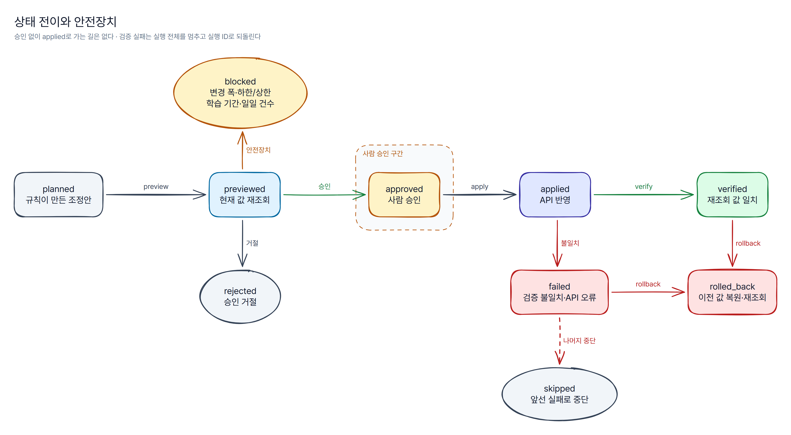

# 안전장치

## 상태 전이

| 지금 | 갈 수 있는 상태 | 누가·언제 |
|---|---|---|
| `planned` | `previewed`, `blocked` | 미리보기: 현재 값 재조회 + 안전장치 검사 |
| `previewed` | `approved`, `rejected`, `blocked` | 사람 승인·거절 |
| `approved` | `applied`, `failed`, `skipped` | 반영(API 오류면 `failed`, 앞선 실패·일일 상한이면 `skipped`) |
| `applied` | `verified`, `failed`, `rolled_back` | 재조회 검증 |
| `verified` | `rolled_back` | 되돌리기 |
| `failed` | `rolled_back` | 되돌리기 |
| `blocked`·`rejected`·`skipped`·`rolled_back` | — | 끝. 다시 하려면 새 조정안 |

표에 없는 전이는 `InvalidTransitionError`로 막힌다. `applied`로 들어오는 길은 `approved`뿐이라 **승인 없는 반영은 구조적으로 불가능**하다(테스트 `test_only_approved_can_reach_applied`).

## 미리보기에서 차단하는 것

| 검사 | 기준 | 메시지 예 |
|---|---|---|
| 계획 이후 값 변경 | 계획 때 이전 값 ≠ 지금 플랫폼 값 | 계획 이후 값이 바뀜(계획 때 130,000원, 지금 140,000원) |
| 변경 폭 상한 | \|변경률\| > `max_change_pct` | 변경 폭 +35.0%가 상한 ±30%를 넘음 |
| 절대 하한·상한 | 새 값이 `bounds` 밖 | 새 값 60원이 하한 70원보다 작음 |
| 학습 기간 보호 | 마지막 변경 후 `cooldown_days` 미만 | 학습 기간 보호: 1일 전에 바뀜 (쿨다운 3일) |
| 일일 건수 상한 | 오늘 반영 건수 + 앞선 통과 건수 ≥ `max_changes_per_day` | 일일 변경 건수 상한 6건 도달 |

차단된 변경은 승인 목록에 올라가지 않는다.

## 반영할 때

1. 상태가 `approved`가 아니면 `ApprovalRequiredError`.
2. 반영 직전에 일일 상한을 다시 본다(승인 뒤 다른 실행이 반영됐을 수 있다). 넘으면 남은 건은 `skipped`.
3. `apply_change` 호출. 일시 오류(503)는 `max_retries`만큼 재시도, 영구 오류(400·404)는 바로 `failed`.
4. **바로 다시 조회**해 값이 새 값과 같으면 `verified`, 다르면 `failed`.
5. 한 건이라도 `failed`면 남은 승인 건은 `skipped`, 실행 상태 `halted`. 사람이 원인을 보고 되돌릴지 정한다.

## 되돌리기

- `adops rollback <실행 ID>` — `applied`·`verified`·`failed` 건을 **역순으로** 이전 값으로 되돌린다.
- 지금 값이 이미 이전 값이면(응답만 성공하고 반영되지 않은 건 등) API를 부르지 않고 `rolled_back`으로 기록한다.
- 되돌린 뒤에도 다시 조회해 이전 값과 같은지 확인한다. 실패하면 `rollback_failed` 이벤트를 남기고 실행 상태를 `rollback_partial`로 둔다(종료 코드 2).

## 감사 로그

`adops history [--run <실행 ID>]`로 시각·실행·단계(이전 → 다음 상태)·내용·주체를 본다. 주체는 `system:planner`, `system:executor`, 승인자(`--actor`), 데모의 `demo:auto-approve`로 구분된다.

## 비밀값

- 이 저장소는 API 키 없이 가짜 API로만 동작한다.
- 실연동 키는 `.env`에만 두고 커밋하지 않는다(`.gitignore`). 키 이름은 `.env.example` 참고.
- 공개 전에는 포트폴리오 공통 점검 스크립트(`qa_scan.py`)로 작업 트리와 git 전체 이력의 비밀값·금지 문자열을 검사한다.
